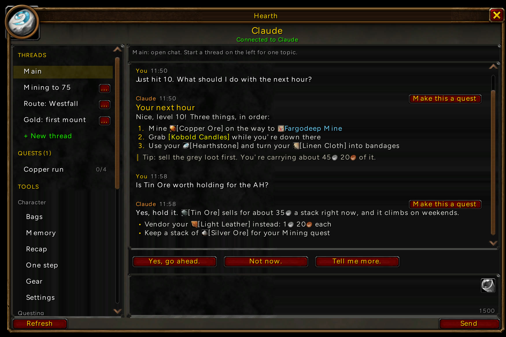
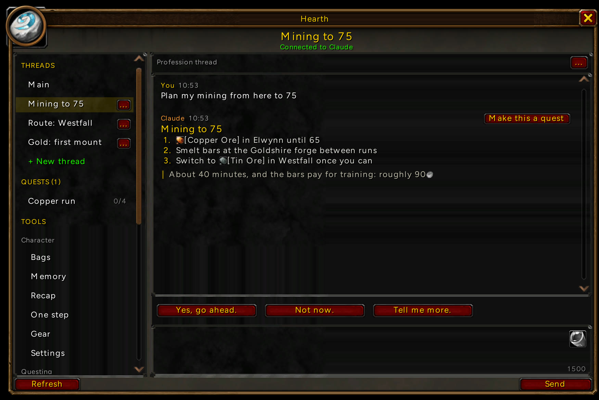
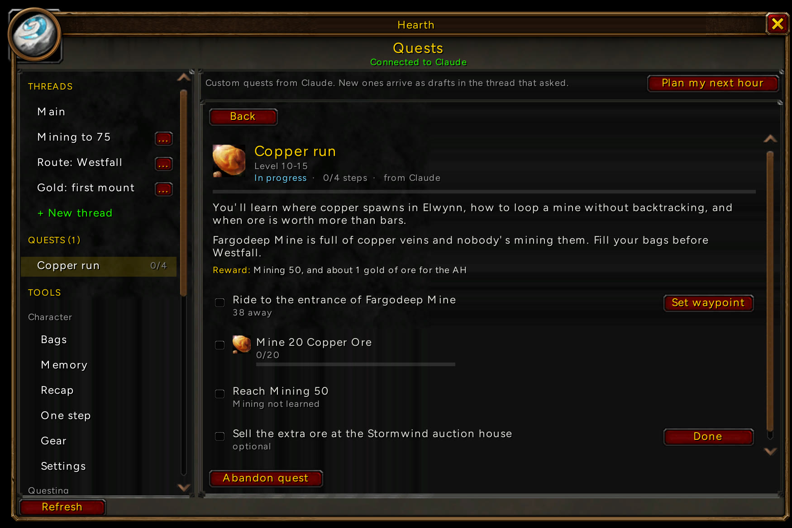
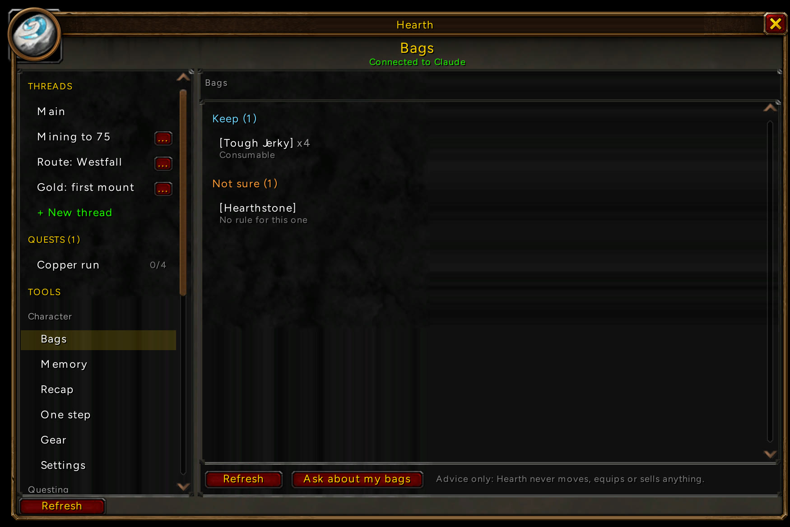

  

<h1 align="center">Darkstorm</h1>

  <b>Claude or Codex, inside World of Warcraft: Forever.</b> 
  Ask from the game, get answers with real item links, map pins and quests you can track.

  <a href="https://github.com/karsonenns/darkstorm/releases/latest">Download</a> ·
  <a href="#getting-started">Getting started</a> ·
  <a href="#how-the-link-works">How it works</a> ·
  <a href="https://github.com/karsonenns/darkstorm/releases">Release notes</a>

## At a glance

- **Chat without alt-tabbing.** `/hearth` opens the window, `/ask <text>` sends from the chat box.
- **Answers that speak WoW.** Items, quests, zones and gold show up as real links and icons.
- **One thread per goal.** Keep "Mining to 75" apart from "Gold: first mount", each with its own memory.
- **Custom quests.** Turn any reply into a tracked quest with steps, waypoints and progress.
- **Knows your character.** Every message carries your level, class, zone, gear and bags.
- **Uses the assistant you already pay for.** Claude Code or Codex on your own computer. No server, no extra account.
- **Advice only.** It never moves, sells, equips or presses anything for you.

## Threads

Start a thread for one goal and it stays on that goal. Replies come with quick answers you can click.

## Custom quests

Hit **Make this a quest** on any reply. Steps track themselves: ore in your bags, skill levels, distance to a waypoint.

## Bags

Sorts what you carry by your own rules, flags anything it isn't sure about, and lets you ask about the rest.

## Getting started

1. Install [Claude Code](https://docs.claude.com/en/docs/claude-code/setup) or Codex (`npm install -g @openai/codex`) and sign in once.
2. Download the [latest release](https://github.com/karsonenns/darkstorm/releases/latest) for Windows or macOS, unzip it and run `hearth-bridge`. It checks your assistant and installs the addon.
3. Restart WoW, then type `/hearth`.

Run `hearth-bridge setup` any time to switch assistants. The bridge updates itself from this repo's releases.

## How the link works

Addons can't open network connections, so the bridge and the addon talk through files on disk, the way the TSM and Raider.IO desktop apps do. Pressing Send reloads the UI for a moment so the game writes your message to disk. Nothing reads the game's screen, memory or network traffic.

MIT licensed. The file-based link builds on an idea from [t3code-wow](https://github.com/ryanrhughes/t3code-wow) (MIT).
